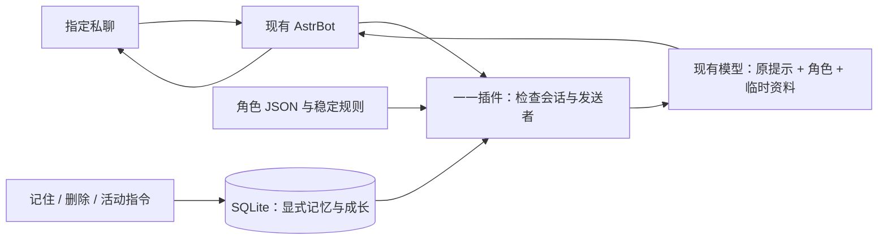

# 最小架构与扩展边界

## 数据流

静态设定在插件启动时读取，追加到已有 `system_prompt`。动态资料在每轮请求时读取，放入临时用户内容。每轮最多注入 8 条、每条最多 500 字的记忆。记忆是用户自述资料，不是模型必须执行的指令；提示词隔离降低误用，不能保证模型完全抵抗提示注入。

普通聊天本身不写长期记忆、不加经验。显式指令通过白名单检查后调用存储。SQLite 参数化查询、写事务、`scope + event_id` 唯一约束分别处理文本转义、并发上限和重复投递。所有操作独立打开并关闭连接；插件使用线程运行磁盘操作，避免阻塞异步消息处理。

`scope = SHA256(JSON([unified_msg_origin, sender_id]))`。这是一种稳定标识，不是加密措施；数据库中记忆正文是明文。私聊白名单、范围过滤和数据目录权限共同决定访问范围。

## 数据表

| 表 | 保存内容 | 约束 |
| --- | --- | --- |
| `memories` | 范围、类别、文本、创建时间 | 同范围相同类别与文本去重；删除必须匹配范围 |
| `profiles` | 每个范围的总经验 | 初始为 0 |
| `activities` | 事件编号、活动类别、北京时间日期、实际得分 | 同范围同事件只登记一次 |

表版本由 `PRAGMA user_version` 管理。版本不受支持或存在未知旧表时拒绝初始化，避免覆盖已有数据。角色 JSON 独立使用 `schema_version`。

## 成长与扩展

当前只有共同活动经验和阶段表达指导。没有模拟情绪、饥饿或好感衰减；更没有对模型权重进行训练。阶段只影响模型得到的表达建议，实际语言质量仍取决于所配置模型。

建议后续按顺序扩展：

1. 完成个人设定确认与真实私聊验收。
2. 为共同经历增加经过确认的简短日记与可修改记录。
3. 如果需要自动总结，先接入已部署的记忆系统，并验证范围和删除行为。
4. 再加入兴趣变化候选、可编辑成长事件和有限频率的主动问候。
5. 最后考虑语音与形象，使它们沿用同一个身份与记忆来源。

角色档案中未来功能的行为约定，不代表目前有对应调度器、审核页面或模型工具。
